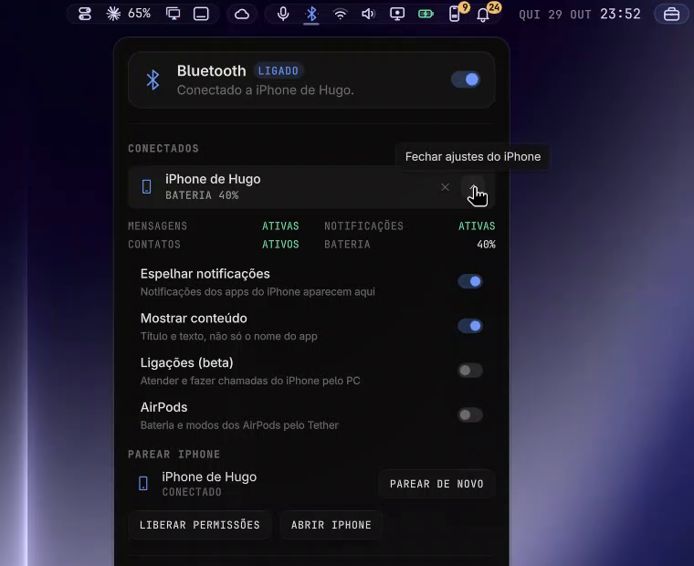
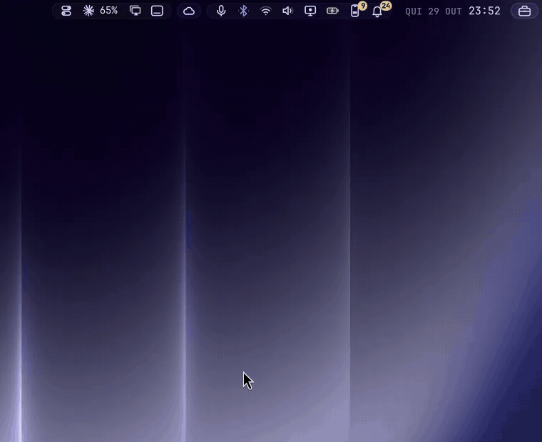

<div align="center">

# Island Bluetooth

**Omarchy's Bluetooth panel, in the Island look.**
Bluetooth device list with connect and disconnect; with Island iPhone, the Tether settings unfold under your iPhone's row, drawn with thin stroke icons and a dark anatomy panel that opens right under its icon.



</div>

## Why this one

- ✏️ **The Island look.** Same stroke icons as [Island Bar](https://github.com/hugorolimf/omarchy-bar),
  colour only when it means something, one easing curve for every transition.
- 🧭 **Opens under its icon**, with the keyboard: Esc closes, Tab moves to the next panel.
- 🌍 **English or Portuguese**, following your system language.
- 🔄 **Drop-in.** It's Omarchy's own `omarchy.bluetooth` underneath (same behaviour, same
  shortcuts and IPC): enabling it takes the original's place on the bar.

## See it

Recorded on a real desktop, mouse and clicks included. The panel follows the
system language; this take is in Portuguese.

**Devices**: what's connected and what's known; with [Island iPhone](https://github.com/hugorolimf/omarchy-island-iphone), your iPhone's row unfolds into its Tether settings.



## Requirements

[Island Kit](https://github.com/hugorolimf/omarchy-island-kit): the panel is drawn with it.
Install the Kit first, or install this panel from the Kit's catalog.
Without the Kit, the plugin shows an "Install Island Kit" button on the bar
(in Portuguese, "Instale o Island Kit"); clicking it installs the Kit and
restarts the shell.

## Install

```bash
omarchy plugin add https://github.com/hugorolimf/omarchy-island-kit --enable
omarchy plugin add https://github.com/hugorolimf/omarchy-island-bluetooth --enable
```

## Remove

```bash
omarchy plugin remove io.github.hugorolimf.bluetooth
```

Omarchy's own bluetooth panel comes back to the bar.

## Credits

A clone of Omarchy's `omarchy.bluetooth` panel by David Heinemeier Hansson and the
[Omarchy](https://github.com/basecamp/omarchy) contributors (MIT); the look, icons and the
Portuguese wording are this plugin's.

## The other Island panels

[Island Sound](https://github.com/hugorolimf/omarchy-island-audio) · [Island Bluetooth](https://github.com/hugorolimf/omarchy-island-bluetooth) · [Island Network](https://github.com/hugorolimf/omarchy-island-network) · [Island Power](https://github.com/hugorolimf/omarchy-island-power) · [Island Display](https://github.com/hugorolimf/omarchy-island-display) · [Island Weather](https://github.com/hugorolimf/omarchy-island-weather)

## License

[MIT](LICENSE)
